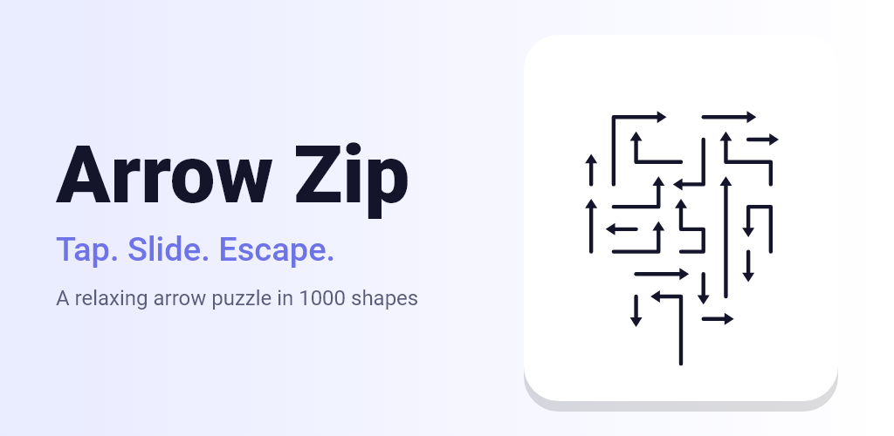
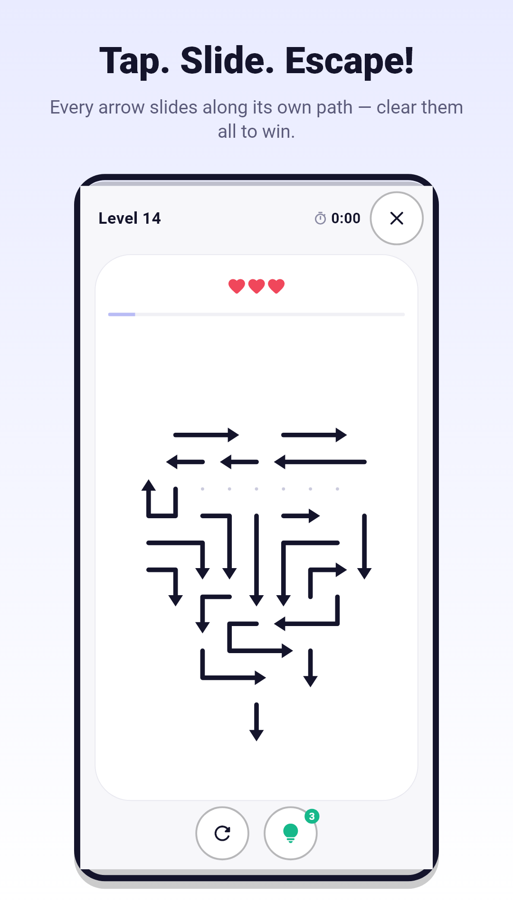
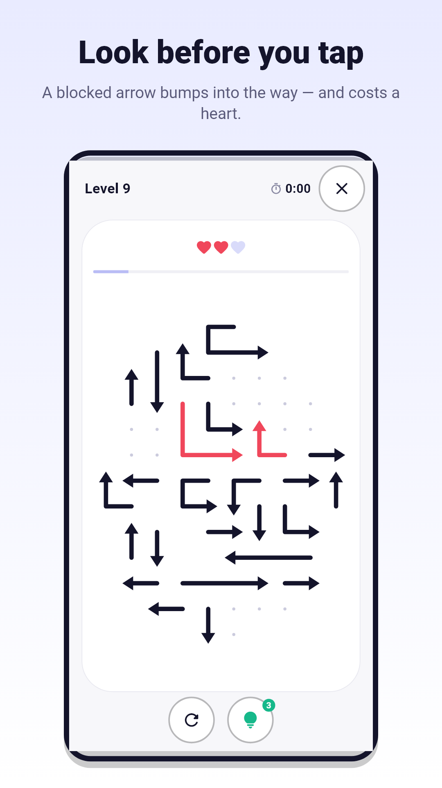
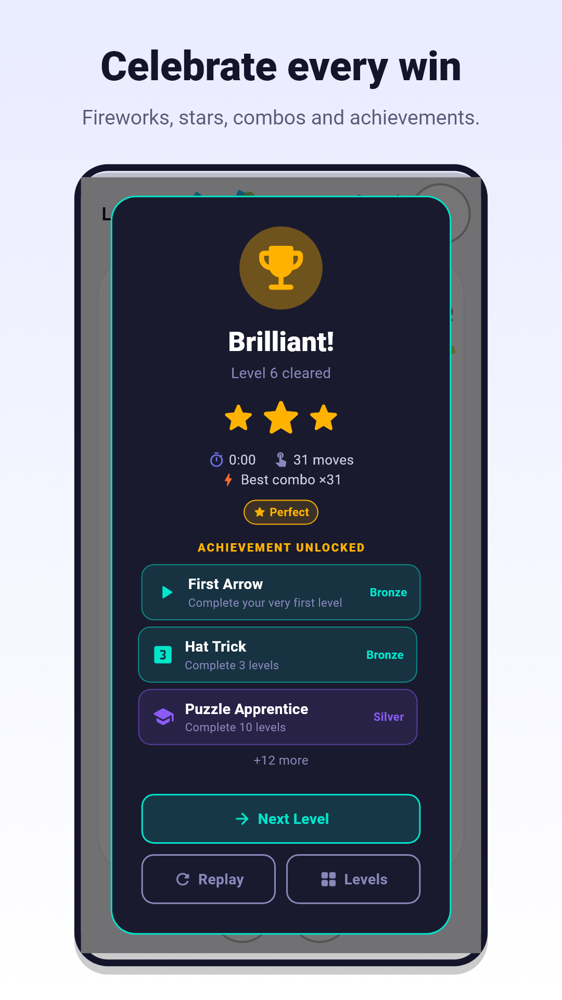
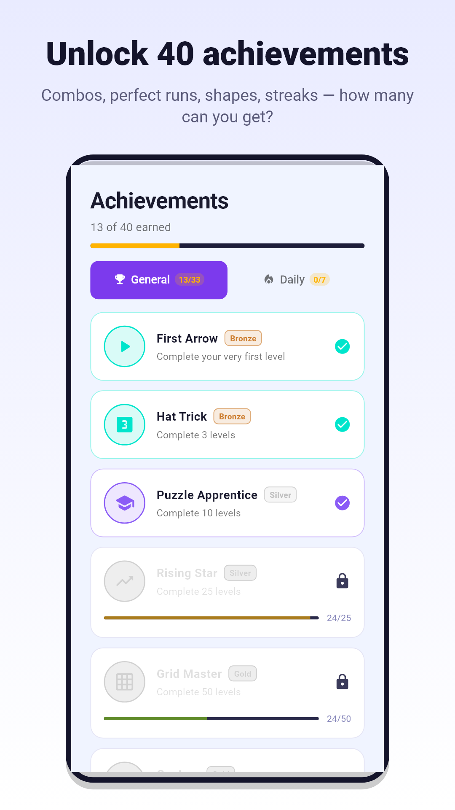

# Arrow Zip

A relaxing arrow puzzle game for Android, built with Flutter.

Tap an arrow and it slides out of the board along its own path. If another
arrow is in the way, it bumps and you lose a heart. Clear the whole board to
win. Currently in closed testing on Google Play.

  
  
  
  

## Features

- 1,000 levels on boards of different shapes (hearts, diamonds, rings and more)
- Snake-shaped arrows that bend and slide out along their path
- Every level is solvable by construction
- Level clock with best times, star ratings and combos
- Hints, three hearts per level, and a step-by-step tutorial
- Daily challenge with streaks
- 40 achievements
- Light and dark themes, phone and tablet layouts
- Optional sign-in (Google or email) and an ad-free subscription

## How the levels are made

Levels are not hand-made. The generator builds each board in reverse: it
starts from an empty board and places arrows one at a time so that each new
arrow can already slide out along its path. Removing them in the reverse order
of placement always clears the board, so every level has at least one
solution. It fills the board from the centre outwards, places long arrows
first and then fills the gaps, which keeps boards dense (about 90%). The level
number seeds the random generator, so the same level always looks the same.

## Tech

- Flutter and Dart, with Riverpod for state
- `CustomPainter` for the board, with slide, bump and hint animations
- Firebase Authentication (Google and email sign-in)
- Google Mobile Ads with UMP consent, and `in_app_purchase` for subscriptions
- Automated tests for the game rules, level solvability and UI
- Play Store screenshots rendered from the real widgets in a Flutter test

## Source code

The source code is private. If you're a recruiter or would like to see parts
of it, get in touch.

## Links

- [Portfolio](https://oware-junior.github.io/portfolio/)
- [LinkedIn](https://www.linkedin.com/in/oware-junior-544099414)
- [Privacy policy](https://oware-junior.github.io/arrow-policy/)

## Author

Made by Oware Junior (Junior Kofi Studios), a student at Ghana Communication
Technology University.

Copyright (c) 2026 Oware Junior. All rights reserved.
